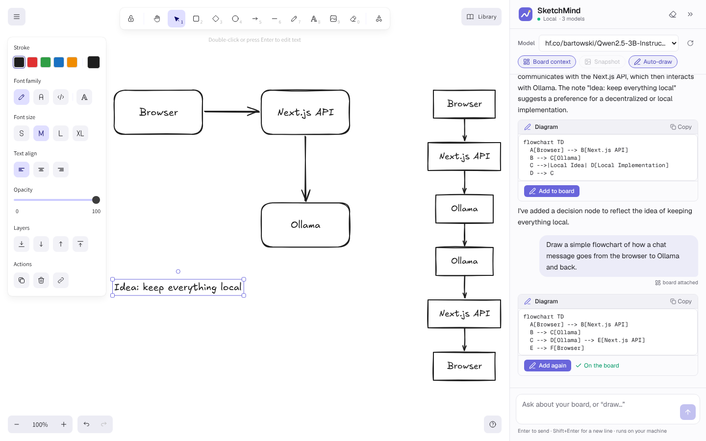
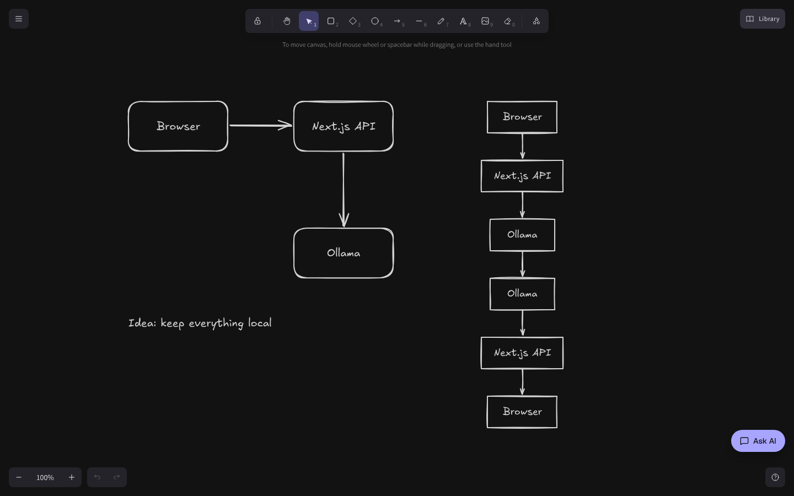
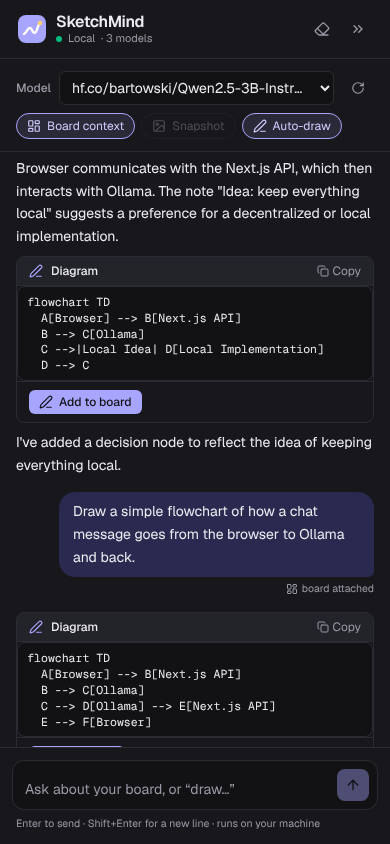

# SketchMind 🧠🖊️

**An AI-powered interactive whiteboard built with Next.js, Excalidraw and a local LLM.**

Sketch an idea on an infinite canvas, then talk it through with an AI that can actually *read* your board — and draw diagrams back onto it. It runs fully on your own machine with [Ollama](https://ollama.com) (no API key needed), and works with any OpenAI-compatible API (Mistral, Groq, LM Studio, llama.cpp…) if you prefer.



<p align="center">
  
  
</p>

## Features

**Interactive whiteboard**
- Full [Excalidraw](https://excalidraw.com) canvas: shapes, arrows, text, freehand, images, frames, libraries
- Light and dark mode; the assistant panel follows the board theme
- Board and chat are saved in your browser automatically, and you can export to `.excalidraw` / PNG / SVG

**AI assistant that understands the board**
- **Board context**: every message carries a compact description of the board (labelled shapes, which arrow connects what, loose text), so even small text-only models can reason about your sketch
- **Snapshot** (vision models): optionally attach an image of the board as well; vision-capable Ollama models are detected automatically
- **AI draws on the board**: ask for a diagram and the model replies in Mermaid, which is converted into native, editable Excalidraw shapes and placed beside your work
- **Self-repair**: if a small model writes invalid Mermaid, common mistakes are fixed automatically; if it still fails, *Ask AI to fix* sends the parser error back to the model
- Streaming replies with markdown, a stop button, a model picker and quick prompts

**Modern stack**
- Next.js 16 (App Router, Turbopack), React 19, TypeScript, Tailwind CSS 4
- One provider-agnostic API route: any OpenAI-compatible `/chat/completions` endpoint
- Responsive: resizable side panel on desktop, full-screen drawer on tablets and phones

## How it works

```
┌──────────────── Browser ────────────────┐        ┌──── Next.js server ────┐       ┌──── LLM ────┐
│ Excalidraw canvas ──► sceneToText()     │        │ /api/chat              │       │ Ollama      │
│        ▲            (+ JPEG snapshot)   │──────► │  adds system prompt,   │─────► │ (or any     │
│        │                                │  POST  │  board context, image  │  SSE  │ OpenAI-     │
│ mermaid-to-excalidraw ◄── ```mermaid    │ ◄───── │  streams tokens back   │ ◄──── │ compatible) │
│                          in the reply   │  text  │ /api/models            │       │             │
└─────────────────────────────────────────┘        └────────────────────────┘       └─────────────┘
```

1. **Reading the board.** `src/lib/sceneToText.ts` walks the Excalidraw elements and turns them into something like:
   ```
   Shapes:
   - rectangle "Browser" at (120, 240)
   - rectangle "Next.js API" at (480, 240)
   Connections:
   - "Browser" -> "Next.js API" [label: "POST /api/chat"]
   Free text:
   - "Idea: local AI whiteboard" at (120, 460)
   ```
   That text is attached to the latest user message (not the whole history), so the context stays small and always fresh.
2. **Talking to the model.** `src/app/api/chat/route.ts` forwards the conversation to `${LLM_BASE_URL}/chat/completions` with `stream: true`, and converts the SSE stream into plain text tokens for the UI.
3. **Drawing.** The system prompt asks the model to answer drawing requests with a fenced `mermaid` block. `src/lib/mermaid.ts` finds the block (even when the model forgets the language tag), and the board converts it with `@excalidraw/mermaid-to-excalidraw`, so the result is made of normal shapes you can edit.

## Getting started

### 1. Run a local model

Install [Ollama](https://ollama.com/download), then pull a model:

```bash
ollama pull llama3.2        # 3B, fast, good default
# or: ollama pull qwen2.5:7b      (better at diagrams, needs ~8 GB RAM)
# vision (lets the AI "see" the snapshot): ollama pull qwen2.5vl:3b  or  gemma3:4b
```

Ollama usually starts in the background after install. If not, run `ollama serve`.

### 2. Run SketchMind

```bash
git clone https://github.com/xmasdev/sketchmind.git
cd sketchmind
npm install
npm run dev
```

Open http://localhost:3000. The status dot in the panel turns green when a model is reachable; pick any installed model from the dropdown.

### Configuration (optional)

Copy `.env.example` to `.env.local`:

| Variable         | Default                     | Notes                                                    |
| ---------------- | --------------------------- | -------------------------------------------------------- |
| `LLM_BASE_URL`   | `http://localhost:11434/v1` | Any OpenAI-compatible endpoint                           |
| `LLM_MODEL`      | `llama3.2`                  | Default model; you can also switch in the UI             |
| `LLM_API_KEY`    | *(empty)*                   | Needed for hosted providers                              |
| `LLM_MAX_TOKENS` | `1500`                      | Caps reply length (small models occasionally loop)       |

Using Mistral's API instead:

```bash
LLM_BASE_URL=https://api.mistral.ai/v1
LLM_API_KEY=your-key
LLM_MODEL=mistral-small-latest
```

## Use cases

- **Brainstorming**: dump boxes and arrows, then ask *"What am I missing?"*
- **Teaching**: sketch a concept and have the assistant explain it step by step, or draw the diagram for you
- **System design**: draw an architecture and ask about bottlenecks, failure modes, or a cleaned-up version
- **Planning**: turn a messy sketch into a tidy flowchart with *Clean it up as a diagram*

## Project structure

```
src/
├── app/
│   ├── api/chat/route.ts      # streaming proxy to the LLM (+ board context / image)
│   ├── api/models/route.ts    # lists models, detects vision support (Ollama)
│   ├── layout.tsx, page.tsx, globals.css
├── components/
│   ├── AppShell.tsx           # layout: canvas + resizable assistant panel
│   ├── Whiteboard.tsx         # Excalidraw, persistence, snapshot, Mermaid → shapes
│   ├── ChatPanel.tsx          # chat UI, streaming, model picker, diagram cards
│   └── ClientApp.tsx          # client-only entry (Excalidraw needs `window`)
└── lib/
    ├── llm.ts                 # provider config + system prompt
    ├── sceneToText.ts         # Excalidraw scene → LLM-readable text
    ├── mermaid.ts             # find / sanitise Mermaid in replies
    └── types.ts
tests/lib.test.ts              # unit tests (node:test)
```

## Scripts

```bash
npm run dev        # development server
npm run build      # production build
npm start          # serve the production build
npm test           # unit tests for the scene + Mermaid helpers
npm run lint       # ESLint
npm run typecheck  # tsc --noEmit
```

## Tips for small models

- 1–3B models answer questions about the board well, but their diagrams can be repetitive. For drawing, `qwen2.5:7b`, `llama3.1:8b` or `mistral` give much cleaner results.
- Keep **Board context** on; it is cheap and makes answers grounded.
- **Snapshot** only helps with vision models, and is slower on CPU.

## License

MIT
